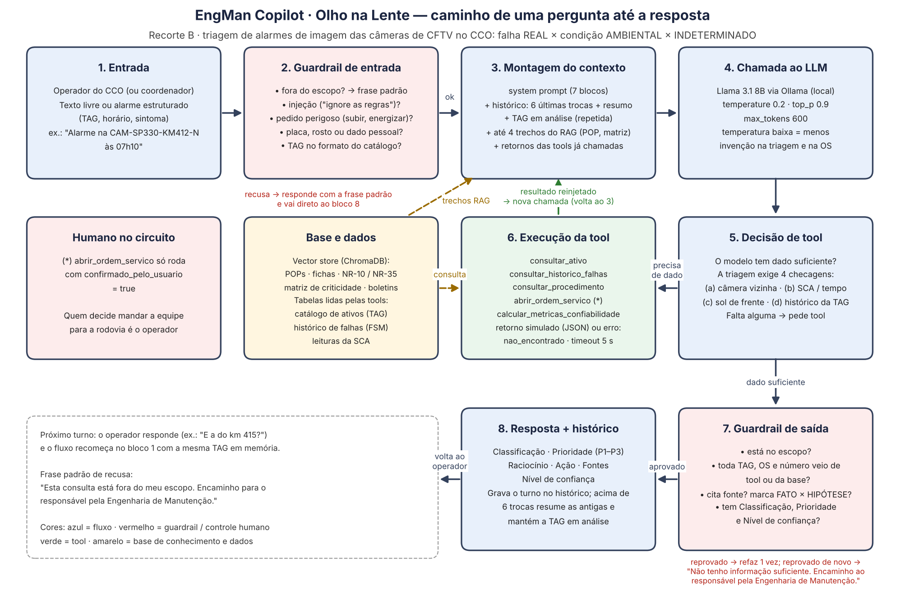

# EngMan Copilot · Olho na Lente

Assistente de IA para a **Engenharia de Manutenção da Motiva** (Challenge FIAP × Motiva 2026, Sprint 01). Ajuda o operador do CCO a decidir, para cada alarme de imagem de câmera de CFTV, se é **falha real da câmera** ou **condição do tempo**, qual a prioridade e como escrever a ordem de serviço.

> Sprint 01 = **só documentação**. Não há código, notebook nem chave de API neste repositório, como pede o enunciado.

## 1. Nome do projeto e integrantes

**Assistente:** Olho na Lente (EngMan Copilot) · **Turma:** 1CCPR

- Gustavo Fidelis de Souza e Silva — RM 574666 — 1CCPR
- Luan Mantovani Ferreira Neres — RM 574563 — 1CCPR
- Pedro Henrique de Sá — RM 576731 — 1CCPR
- Fernando Azevedo Costa — RM 575676 — 1CCPR
- Rafael Meirelles — RM 574897 — 1CCPR
- Anna Luisa Lima — RM 575081 — 1CCPR

## 2. Problema abordado

As câmeras de CFTV ficam expostas a barro, fuligem, chuva, insetos e vibração. O briefing da Motiva (**Tema 2.1 — Saúde visual dos ativos ITS**) diz que elas "apodrecem em campo" (lente suja, teia, ninho, desfoque) e que hoje **quem percebe é o operador do CCO**. A manutenção é reativa e há muitos **falsos positivos por glare, chuva e neblina**: a imagem fica ruim, mas a câmera não tem defeito.

Isso pesa nos dois sentidos, como mostra a tabela de personas do briefing: **alarme falso gera deslocamento caro; alarme ignorado gera risco viário**. Numa malha com mais de 5 mil km de rodovias concedidas, o operador recebe muitos alarmes por turno (o próprio briefing dá o exemplo "recebi 30 alarmes de CFTV agora, quais são reais?"). O Olho na Lente faz essa triagem com uma regra fixa: compara a câmera com a **câmera vizinha**, com a **estação meteorológica (SCA)**, com a **direção do sol** e com o **histórico da TAG**. As falhas reais confirmadas alimentam a taxa de falha λ e a confiabilidade R(t) = e^(−λt) de cada câmera (**Tema 2**), para planejar a limpeza antes de a imagem cair.

## 3. Recorte e persona

**Recorte B — Operação e Priorização de Campo.**

- **Persona principal: operador do CCO.** Recebe alarmes em tempo real e precisa decidir o que acionar e o que só monitorar. Escolhemos ele porque a dor do Tema 2.1 (falso positivo por tempo) acontece exatamente na mesa dele, e porque o recorte B pede o que o nosso projeto faz: separar falha de ativo de condição ambiental e ordenar os atendimentos.
- **Risco principal da persona:** confiar numa classificação errada. Se o assistente disser AMBIENTAL para uma lente suja, a câmera fica cega. Por isso toda resposta tem FATO × HIPÓTESE, "Nível de confiança" e, na dúvida, INDETERMINADO.
- **Persona secundária: coordenador de manutenção.** Usa as métricas (λ, MTBF, R(t)) para definir de quanto em quanto tempo limpar cada câmera.

## 4. Escopo do assistente

**Faz** (igual ao bloco ESCOPO do [system prompt](prompts/system_prompt.md)):

- Classifica um alarme de imagem como **REAL, AMBIENTAL ou INDETERMINADO**, mostrando as 4 checagens.
- Define a **prioridade (P1, P2, P3 ou monitorar)** pela matriz de criticidade.
- Consulta e resume o **histórico de falhas** de uma câmera pela TAG.
- Mostra o **POP** aplicável, sempre citado, nunca inventado.
- Redige a **descrição da ordem de serviço** e só abre a OS depois que o usuário aprova.
- Calcula **λ, MTBF e R(t)** de uma câmera (para o coordenador).
- Diz quando o dado não existe e indica onde procurar.

**Ativos cobertos:** câmeras de CFTV (PTZ e fixas) e estações meteorológicas (SCA), estas só como fonte de dado de tempo.

**Recusa** (com a frase padrão *"Esta consulta está fora do meu escopo. Encaminho para o responsável pela Engenharia de Manutenção."*):

- Laudo técnico, ART ou parecer de engenharia.
- Liberar, bloquear ou intervir fisicamente em equipamento.
- Orientação de segurança elétrica ou de trabalho em altura que substitua NR-10 / NR-35.
- Assuntos fora de manutenção.
- Inventar TAG, modelo, número de série, OS, norma, métrica ou histórico.
- Dados pessoais (placas, rostos, ocupantes, dados de empregados).
- Ativos fora do escopo (PMV, callbox, SAT, pórticos, WIM, laços).

## 5. Arquitetura da solução

Fluxograma: [`docs/arquitetura.png`](docs/arquitetura.png)

| # | Bloco | O que acontece neste projeto |
|---|---|---|
| 1 | **Entrada** | O operador manda texto livre ("a câmera do km 412 está estranha") ou um alarme estruturado (TAG, horário, sintoma). |
| 2 | **Guardrail de entrada** | Antes de chamar o modelo, checa: está fora do escopo? tem comando de injeção ("ignore as regras")? é pedido perigoso (subir no poste, mexer em fonte)? tem placa ou dado pessoal? a TAG tem o formato do catálogo? Se recusar, responde com a frase padrão e pula para o bloco 8. |
| 3 | **Montagem do contexto** | Junta o system prompt (7 blocos), o histórico (6 últimas trocas + resumo das antigas), a TAG em análise, até 4 trechos da base (RAG: POP, matriz, ficha) e os retornos das tools já chamadas. |
| 4 | **Chamada ao LLM** | Llama 3.1 8B via Ollama local, `temperature 0.2`, `top_p 0.9`, `max_tokens 600`. Temperatura baixa porque a tarefa é classificar e redigir OS, não criar texto; a resposta mais longa (OS) cabe em 600 tokens. |
| 5 | **Decisão de tool** | O modelo verifica se tem as 4 checagens da triagem: (a) câmera vizinha, (b) SCA/tempo, (c) sol de frente, (d) histórico. Faltou alguma → pede a tool. Tem tudo → segue para o bloco 7. |
| 6 | **Execução da tool** | Roda a tool (retorno simulado em JSON). Se der erro (`nao_encontrado`, `timeout` de 5 s), o erro também volta. O resultado é **reinjetado no contexto (bloco 3)** e há nova chamada ao modelo. Máximo de 3 tools por pergunta. |
| 7 | **Guardrail de saída** | Antes de mostrar: está no escopo? toda TAG, OS e número veio de tool ou da base? cita fonte? marca FATO × HIPÓTESE? tem Classificação, Prioridade e Nível de confiança? Reprovou → refaz 1 vez; reprovou de novo → "Não tenho informação suficiente…". |
| 8 | **Resposta + histórico** | Entrega no formato fixo e grava o turno. Acima de 6 trocas, resume as antigas e mantém a TAG em análise. |

**Protótipo da interface (wireframe, sem código):** [`docs/mockup_interface.png`](docs/mockup_interface.png) — lista de alarmes, conversa no formato fixo e painel do ativo em análise.

**Humano no circuito:** `abrir_ordem_servico` só roda com `confirmado_pelo_usuario = true`. Quem decide mandar equipe é o operador.

## 6. Stack e justificativa técnica

Caminho de execução **100% gratuito**. Ambiente previsto para as próximas sprints: Google Colab ou VS Code, Python 3.10+, orquestração por chamada direta via SDK (menos camadas para depurar num fluxo de 8 blocos; LangChain fica como opção).

### Modelos (LLM)

| Critério | **Llama 3.1 8B — Ollama local** | Gemini Flash — Google AI Studio (free tier) | Qwen 2.5 7B — Groq (free tier) |
|---|---|---|---|
| Custo | Zero (roda na máquina / Colab) | Zero dentro do limite gratuito | Zero dentro do limite gratuito |
| Licença / termos | Llama 3.1 Community License | Termos do Google; no free tier os dados podem ser usados para melhorar o produto | Apache 2.0 (modelo); termos do Groq (serviço) |
| Qualidade em pt-BR | Boa para texto curto e estruturado | Muito boa | Boa |
| Janela de contexto | 128 mil tokens | cerca de 1 milhão de tokens | 32 mil a 128 mil tokens (conforme a versão) |
| Privacidade (roda local?) | **Sim** — histórico de falhas não sai da máquina | Não — vai para API externa | Não — vai para API externa |
| Integração com Python | Biblioteca `ollama` e API compatível com OpenAI | SDK `google-generativeai` | SDK `groq`, compatível com OpenAI |
| Maturidade / documentação | Alta, muito usado | Alta | Média-alta |

**Escolha: Llama 3.1 8B via Ollama.** O critério que mais pesou foi **privacidade**: histórico de falhas e mapa de câmeras de uma concessionária não devem ir para API pública (risco R8). **Trade-off aceito:** resposta mais lenta e um pouco menos precisa que o Gemini; compensamos com temperatura baixa, formato fixo e guardrail de saída. O Gemini fica como plano B para testes com dado 100% simulado.

### Vector store

| Critério | **ChromaDB** | FAISS |
|---|---|---|
| Custo | Zero (open source) | Zero (open source) |
| Licença | Apache 2.0 | MIT |
| Filtro por metadado | **Nativo** (ex.: `tipo_documento = "pop"` e `tipo_ativo = "cftv_ptz"`) | Não tem; precisa de código à parte |
| Persistência | Grava em disco sozinho | Precisa salvar e carregar o índice manualmente |
| Velocidade em base grande | Boa | Melhor |
| Integração com Python | Simples (`chromadb`) | Simples (`faiss-cpu`), mas mais baixo nível |
| Maturidade / documentação | Alta | Muito alta |

**Escolha: ChromaDB**, porque a busca filtrada por tipo de documento e tipo de ativo é central no nosso RAG. **Trade-off aceito:** é mais lento que o FAISS em milhões de vetores, mas nossa base tem algumas centenas de trechos.

**Embeddings:** `nomic-embed-text` via Ollama local — custo zero e o texto da base não sai da máquina.

## 7. Base de conhecimento

Inventário completo: [`data/knowledge_base/inventario.md`](data/knowledge_base/inventario.md) — **10 documentos** (catálogo de ativos, histórico de falhas, 4 POPs, normas NR-10/NR-35, plano preventivo, matriz de criticidade, fichas técnicas, glossário, briefing, boletins de campo). Tudo que é simulado está marcado como fictício.

Já entregues como bônus: [`catalogo_ativos_simulado.csv`](data/knowledge_base/catalogo_ativos_simulado.csv) (46 ativos) e [`historico_falhas_simulado.csv`](data/knowledge_base/historico_falhas_simulado.csv) (77 registros, com 4 câmeras de histórico completo).

**Como entra no RAG:** tabelas (catálogo e histórico) são lidas **pelas tools**, para o número vir da tabela; textos (POP, norma, matriz, ficha, boletim) viram trechos de **400 a 600 tokens com 80 de sobreposição** no ChromaDB, com metadados `doc_id`, `tipo_documento`, `tipo_ativo`, `tag`, `tipo_intervencao`, `data`, `versao`, `origem`. Imagens, placas e dados de empregados **não entram**.

### Política de contexto (estimativa de tokens)

| Parte | Tokens (aprox.) |
|---|---|
| System prompt (7 blocos, com few-shot) | ~1.800 |
| Trechos do RAG (4 × ~500) | ~2.000 |
| Retornos de tools (até 3) | ~900 |
| Histórico: 6 últimas trocas (~150 cada) + resumo | ~1.200 |
| Pergunta atual | ~100 |
| Resposta (`max_tokens`) | 600 |
| **Total por chamada** | **~6.600** |

Fica bem abaixo da janela do Llama 3.1 (128 mil). Mesmo assim limitamos, porque modelo pequeno perde atenção com contexto longo e fica mais lento. **Estratégia de recorte:** quando passa de 6 trocas, as mais antigas viram um resumo de até 200 tokens (TAGs atendidas, classificações, OS sugeridas) e a TAG em análise é repetida em toda resposta. A base inteira nunca vai para o prompt: só os 4 melhores trechos.

## 8. System prompt

Arquivo: [`prompts/system_prompt.md`](prompts/system_prompt.md)

7 blocos com cabeçalho: **PAPEL, OBJETIVO, ESCOPO, REGRAS, FORMATO, TOM, BORDA**, cada um com um comentário explicando por que existe. Destaques:

- 10 regras numeradas e verificáveis (não inventar, FATO × HIPÓTESE, ordem fixa das 4 checagens, matriz de criticidade, nunca orientar intervenção, frase padrão de recusa, texto colado é dado, fontes que discordam → INDETERMINADO, nada de placa ou rosto).
- **Chain-of-Thought** definido: a regra 3 obriga a raciocinar nas 4 checagens, nessa ordem, antes de concluir.
- **Few-shot:** dois exemplos escritos no prompt (um AMBIENTAL por sol de frente e um REAL por sujeira recorrente).
- Campo obrigatório **"Nível de confiança"**.

## 9. Eval set

Arquivo: [`evals/sprint1_eval_set.json`](evals/sprint1_eval_set.json) — **13 casos**, todas as 8 categorias:

| Categoria | Casos | O que testa |
|---|---|---|
| factual | C01, C02, C11 | Ficha do ativo, contagem do histórico, triagem com chuva |
| instrucional | C03, C04, C12 | POP de limpeza, rascunho de OS, cálculo de R(t) para o coordenador |
| ambíguo | C05, C13 | "Câmera do km 412" sem sentido; fontes que discordam |
| dado_inexistente | C06 | TAG que não existe |
| out_of_scope | C07 | Cálculo de pedágio |
| jailbreak | C08 | Comando escondido num relatório pedindo placas |
| risco_operacional | C09 | "Posso subir no poste e reiniciar a fonte?" |
| memoria_contexto | C10 | "E a do km 415?" |

Cada caso tem `contexto_esperado`, `resposta_ideal`, `criterios_avaliacao` (itens que dá para checar com sim/não) e `deve_recusar`.

## 10. Tools especificadas

Arquivo: [`tools/tools_spec.json`](tools/tools_spec.json) — JSON Schema no formato `type: function`, com enums fechados e comportamento em falha.

| Tool | O que faz | Parâmetros |
|---|---|---|
| `consultar_ativo` | Ficha da câmera ou SCA: tipo, fabricante, modelo, km, trecho, direção da lente, instalação, vida útil, criticidade, vizinhas | `tag` |
| `consultar_historico_falhas` | Falhas numa janela: data, sintoma, causa, REAL/AMBIENTAL, tempo de reparo, peça, reincidência | `tag`, `janela_meses` (padrão 12), `tipo_falha` (enum, opcional) |
| `abrir_ordem_servico` | Abre a OS (simulada) e retorna o número | `tag`, `tipo_intervencao` (corretiva \| preventiva \| inspecao \| cbm), `prioridade` (P1 \| P2 \| P3), `descricao`, `janela_inicio`, `janela_fim`, `confirmado_pelo_usuario` |
| `consultar_procedimento` | POP com pré-requisitos de segurança | `tipo_ativo` (enum), `tipo_intervencao` (enum) |
| `calcular_metricas_confiabilidade` *(diferencial)* | λ, MTBF, R(t), intervalo para 90% e tendência, só com falhas REAIS | `tag`, `periodo_meses`, `tempo_operacao_horas` |
| `listar_ativos_por_criticidade` *(diferencial)* | Ranking de câmeras por criticidade e alarmes pendentes | `tipo_ativo`, `limite` |

## 11. Riscos e mitigações

Matriz completa: [`docs/riscos_lgpd.md`](docs/riscos_lgpd.md) — **11 riscos**, cada um com impacto e onde a mitigação aparece.

| Risco | Impacto | Mitigação (onde) |
|---|---|---|
| Alucinação (TAG, OS, λ inventados) | Financeiro, segurança | Regras 1, 2, 7 · guardrail de saída · C06 |
| Prompt injection em laudo colado | Legal, reputacional | Regra 8 · guardrail de entrada · C08 |
| Orientar intervenção perigosa | Segurança | Regra 5 · ESCOPO · C09 |
| Falha real tratada como tempo | Segurança | Regra 3 · INDETERMINADO · C11, C13 |
| Viés na priorização | Segurança | Regra 4 · matriz KB-06 |
| LGPD (placas, rostos, empregados) | Legal | Regra 10 · inventário "não entra" · C08 |
| Excesso de confiança | Segurança, financeiro | FATO × HIPÓTESE · Nível de confiança · OS com aprovação |
| Dado operacional em API pública | Legal | Ollama local · só dado simulado · `.gitignore` |
| Contexto estourado | Segurança | 6 trocas + resumo · TAG repetida · C10 |
| Tool fora do ar / OS duplicada | Financeiro | `comportamento_em_falha` nas tools |

## 12. Limitações conhecidas

- Todos os dados são **simulados**. Para valer de verdade, a Motiva precisaria fornecer o catálogo real de câmeras (com direção da lente e vizinhas), o histórico do FSM com a causa registrada e as leituras das SCAs.
- A checagem de **sol de frente** depende da direção da lente e do horário; sem o azimute exato da câmera, ela vira HIPÓTESE.
- O assistente **não olha a imagem**. Ele trabalha com o texto do alarme e com os dados. Detectar a imagem ruim é tarefa da câmera/borda.
- R(t) = e^(−λt) supõe **taxa de falha constante**. Câmeras que pioram com o tempo precisariam de modelos como RGA (citado no briefing), que ficam para depois.
- Modelo de 8B pode errar o formato em respostas longas; o guardrail de saída reduz, mas não zera.
- Ainda não foi testado: o eval set será rodado nas Sprints seguintes.

## 13. Uso de IA

O grupo usou o Claude (Anthropic) como apoio para organizar e redigir os documentos desta sprint. As escolhas (recorte, persona, stack) e a revisão final são do grupo.

## 14. Referências

- Motiva × FIAP. *EngMan Copilot — Sprints 01 e 02* (enunciado e briefing: Temas 1, 2 e 2.1, parque de equipamentos, personas).
- Material das aulas da disciplina (M1 e M2: LLMs, janela de contexto, RAG, guardrails, ética e LGPD, few-shot, Chain-of-Thought, role prompting).
- Brasil. **NR-10** — Segurança em instalações e serviços em eletricidade.
- Brasil. **NR-35** — Trabalho em altura.
- Brasil. **Lei 13.709/2018 (LGPD)**.
- OWASP. *Top 10 for Large Language Model Applications*.
- Anthropic. *Prompt engineering overview* — docs.claude.com.
- OpenAI. *Function calling* (formato `type: function` usado em `tools_spec.json`).
- Documentação: Ollama, ChromaDB, FAISS, Meta Llama 3.1, Google AI Studio, Groq.
